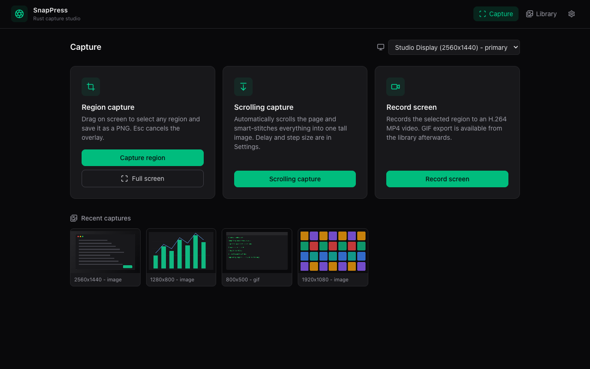
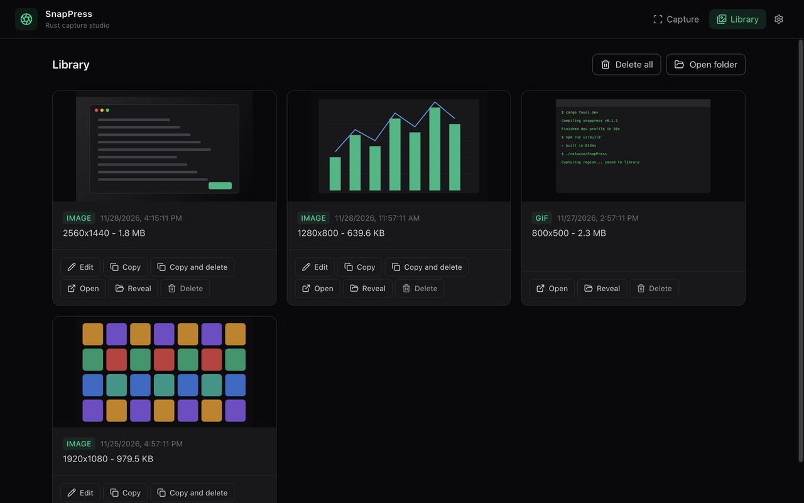
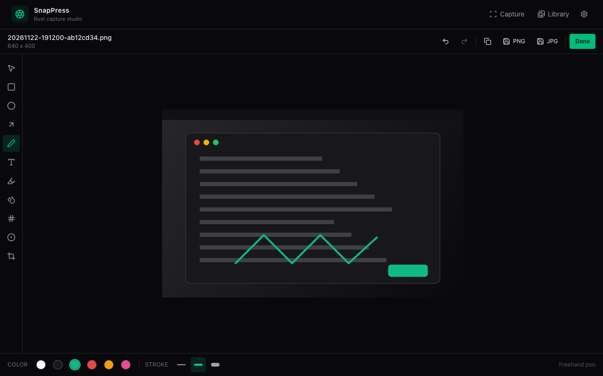
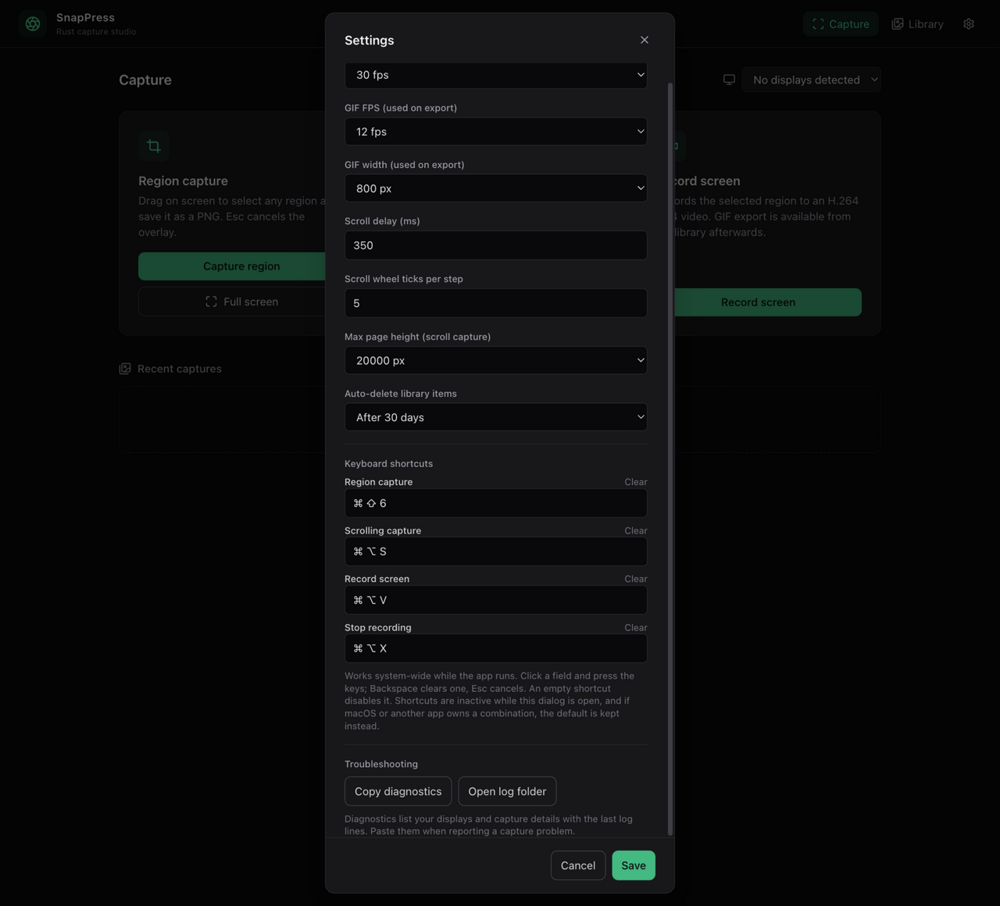
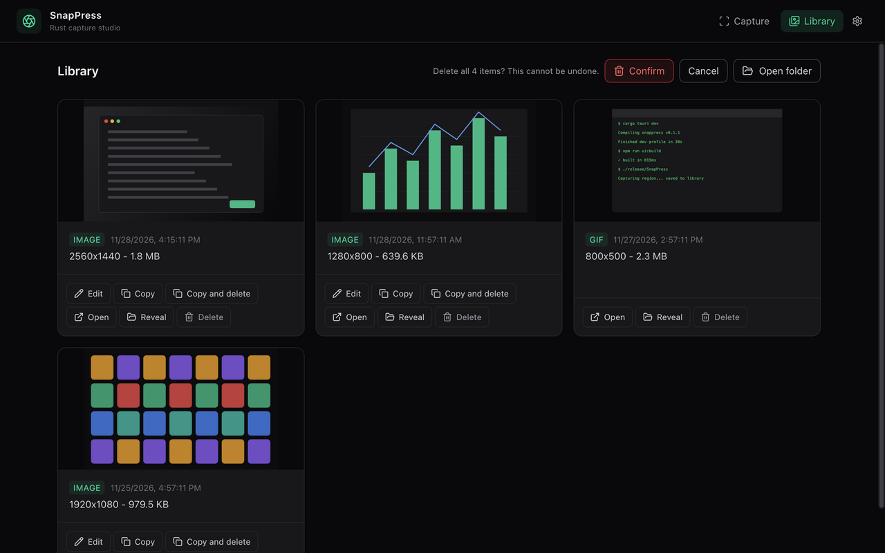

# SnapPress

[](https://github.com/CJ-1981/snappress/actions/workflows/build.yml)

A Screenpresso-style screen capture, scrolling capture and recording studio,
rebuilt in Rust with Tauri 2 for **Windows** and **macOS**.

- Region and fullscreen capture through a transparent, always-on-top overlay
- Scrolling capture that auto-scrolls a page and smart-stitches it into one tall image
- Screen recording to MP4 (H.264) with GIF export from the library
- Built-in annotation editor (arrows, shapes, pen, text, blur/pixelate, numbered
  steps, highlight, crop, undo/redo)
- Capture library with thumbnails, clipboard copy, reveal-in-folder, delete-all
  and auto-delete after a configurable period
- Global hotkeys plus a system tray menu; the main window hides to tray on close

## Screenshots

| Capture | Library |
| --- | --- |
|  |  |
| **Editor** | **Settings** |
|  |  |

Delete the whole library in one confirmed step:



## Downloads

Grab the latest installers from
[Releases](https://github.com/CJ-1981/snappress/releases): DMGs for macOS
(Apple Silicon + Intel) and NSIS/MSI installers for Windows x64. Releases are
published automatically when a `v*` tag is pushed; every push to `main` also
produces per-commit artifacts on the workflow run.

### First launch on macOS

The builds are ad-hoc signed (no Apple Developer certificate), so Gatekeeper
takes one extra step the first time:

1. Install and launch — macOS may say the app *"can't be verified"*.
   Right-click the app and choose **Open**, or allow it under
   System Settings → Privacy & Security ("Open Anyway").
2. Grant **Screen Recording** when prompted (or use the banner in the app —
   it opens the right pane for you and refreshes once granted).
3. Scrolling capture additionally needs **Accessibility**.

If macOS ever claims the app is *"damaged"*, strip the download quarantine
flag once: `xattr -rd com.apple.quarantine /Applications/SnapPress.app`.

## Repository layout

```
snappress/
  index.html / overlay.html   Two webview entries: main window + capture overlay
  src/                        React UI (Vite + TypeScript + Tailwind 4)
    lib/                      Typed invoke wrappers + shared types
    views/                    Capture view, library view, canvas editor
    components/               Recorder bar, scroll progress card, settings dialog
    RegionOverlay.tsx         Region selection overlay (separate window)
  src-tauri/
    src/capture/              scap-backed display grab + scrolling stitcher
    src/encode/               ffmpeg pipe recorder (MP4) + GIF converter
    src/input/                enigo cursor move + wheel scroll injection
    src/commands/             Tauri command handlers
    src/state.rs              App state: settings, library index, job handles
    capabilities/             Tauri 2 permission set
  scripts/gen_icons.py        Regenerates the icon set from app-icon.png
```

## Prerequisites

| Platform | Requirements |
| --- | --- |
| Both | Rust 1.77+ (`rustup`), Node.js 18+ (npm), first recording downloads ffmpeg (~80 MB) automatically |
| Windows | Windows 10 1903+ (DirectX Graphics Capture), WebView2 runtime (auto-installed by the Tauri bundler), MSVC Build Tools |
| macOS | macOS 12.3+ (ScreenCaptureKit), Xcode Command Line Tools |

macOS permissions (granted on first use, System Settings > Privacy & Security):

- **Screen Recording** - required for any capture/recording
- **Accessibility** - required for scrolling capture (simulated wheel scroll)

## Run and build

```bash
cd snappress
npm install
npm run tauri dev     # development build with hot reload
npm run tauri build   # production bundles (dmg/app on macOS, msi/nsis on Windows)
```

The UI can also be built standalone (`npm run ui:build`) for typechecking and
Vite output; the Tauri CLI wires it into the desktop app.

## Global hotkeys

| Action | Windows | macOS |
| --- | --- | --- |
| Region capture | `PrintScreen` | `Cmd+Shift+6` |
| Scrolling capture | `Ctrl+Alt+S` | `Cmd+Alt+S` |
| Record screen | `Ctrl+Alt+V` | `Cmd+Alt+V` |
| Stop recording | `Ctrl+Alt+X` | `Cmd+Alt+X` |

Hotkey registration failures (for example a conflicting macOS binding) are
logged to the console and do not prevent startup.

## How the pieces work

### Region capture
`start_region_capture` creates a borderless, transparent, always-on-top window
sized to the chosen monitor. The overlay page measures the dragged rectangle in
CSS pixels, converts to physical pixels with `devicePixelRatio`, and invokes
`capture_region`. The backend closes the overlay, grabs a full frame and
crops the saved PNG. The frame comes from Windows.Graphics.Capture on Windows
and ScreenCaptureKit on macOS; when the former cannot run, the capture is
retried through GDI. Capture sessions are stopped as soon as they are dropped,
and every wait is bounded, so a capture ends in an image or a visible error.

### Scrolling capture
`run_scroll_session` (in `src-tauri/src/capture/stitch.rs`) moves the cursor
into the region, then loops: scroll the wheel down with `enigo`, wait, grab a
new frame, and align it against the stitched tail using per-row luminance
profiles of four vertical bands (coarse scan + local refinement). Only rows
below the detected overlap are appended. The loop stops when the page stops
moving (bottom reached), the max height is hit, or the user cancels. Progress
events drive the live preview card in the main window.

### Recording (MP4 + GIF)
`run_record` spawns ffmpeg through `ffmpeg-sidecar` (auto-download on first
run) and pipes raw RGBA frames cropped from each display frame into it
(`-f rawvideo -pix_fmt rgba` -> libx264 -> faststart MP4). Pause/resume simply
gates the frame pump; stopping drops stdin so ffmpeg finalizes the container.
GIF export runs the two-pass `palettegen`/`paletteuse` filter chain over the
recorded MP4 with configurable FPS and width.

### Editor
Pure canvas implementation in `src/views/EditorView.tsx` + `src/views/editor/
render.ts`. Layers are drawn over the base image in image-pixel space; blur and
pixelate are implemented with double `drawImage` down/up-scaling (no
`ctx.filter`, which macOS WebKit does not support). The base image is loaded
through `read_image_base64` so the canvas never becomes tainted, which keeps
PNG/JPEG export working. Exports are saved back into the library as new items.

## Settings

Stored in the app data directory as `settings.json` (library index:
`index.json`, captures: `captures/`):

- Recording FPS (15/24/30), GIF FPS and GIF width (used on export)
- Scroll delay (ms), wheel ticks per step, max page height
- Auto-delete library items: Never / 1 / 7 / 30 / 90 / 365 days. Pruning runs
  at startup and whenever the library loads, deleting the capture files along
  with the index entries.

## Known limitations (v1)

- On macOS, displays are paired with monitors by enumeration order when their
  names are not unique, so two identical monitors may be swapped. Windows
  pairs them by device name, which is exact.
- On Windows, captures taken through the GDI fallback never include the
  mouse cursor.
- Fixed headers/sidebars inside scrollable pages can produce ghosting in
  stitched captures (typical for this class of tool).
- Recording is MP4 only; GIF is produced by converting a recording.
- No per-window capture mode yet (regions cover that use case).

## Troubleshooting

- **A capture fails** - the main window comes back and shows the reason in a
  red banner on the Capture tab (and as a toast). Captures cannot leave the
  app hidden: a watchdog brings the window back after 30 seconds whatever
  went wrong.
- **Black frames or "capture failed" on macOS** - grant Screen Recording;
  the app shows a banner with a shortcut to the right System Settings pane
  and refreshes once the permission is granted. A restart may still be
  required for a running capture to pick it up.
- **"capture session failed to start" on Windows** - Windows.Graphics.Capture
  is unavailable on that machine (common in remote desktop and VM sessions,
  or with some GPU drivers). Region, full-screen and scrolling captures fall
  back to plain GDI automatically; screen recording needs
  Windows.Graphics.Capture and does not.
- **Reporting a capture problem** - open Settings → Troubleshooting →
  **Copy diagnostics** and paste the result. It lists every display with the
  monitor that shows it, whether the capture API is available, any fallback
  in use, and the last log lines.
- **"damaged and can't be opened" on macOS** - see "First launch on macOS"
  above (download quarantine on an ad-hoc signed build).
- **"failed to scroll" on macOS** - grant Accessibility permission.
- **Where are the logs?** File logging goes to `snappress.log` in the app log
  dir: `~/Library/Logs/app.snappress.desktop/` on macOS and
  `%LOCALAPPDATA%\app.snappress.desktop\logs\` on Windows. Capture starts,
  failures and ffmpeg state are all logged there — attach it when reporting
  capture problems.
- **"ffmpeg has no stdin" / spawn errors** - make sure the first-run ffmpeg
  download completed; delete the `ffmpeg-exe` folder inside the app data
  directory to force a re-download.
- **Crate API drift** - `scap` 0.0.8 is vendored at `src-tauri/vendor/scap`
  (patched for windows-capture 1.5.0, see `vendor/scap/VENDORED.md`) and
  pinned via `[patch.crates-io]`; the remaining crates are version-pinned in
  `Cargo.toml`/`Cargo.lock`. If a dependency publishes breaking changes, pin
  the exact patch version or adjust the small surface area in
  `capture/mod.rs` (frame access), `input/mod.rs` (scroll sign/units) and
  `encode/mod.rs` (ffmpeg arguments).
